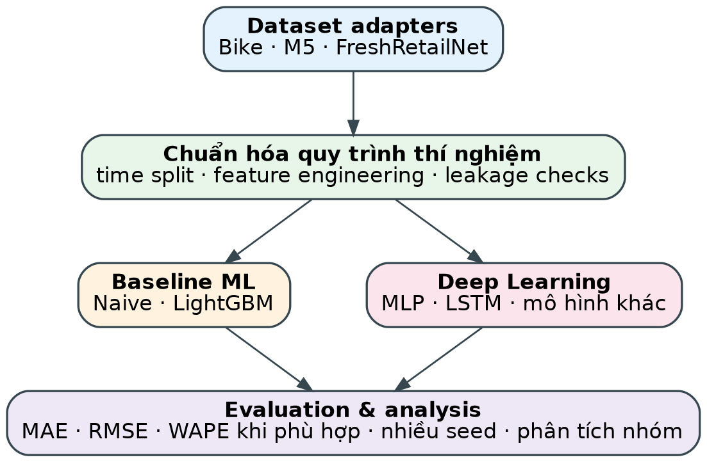

# Khảo sát dataset cho TabM và dự báo nhu cầu

Repo này tập hợp các dataset công khai, nhẹ và có citation để học deep learning trên dữ liệu bảng, đặc biệt là TabM, cùng một benchmark forecasting nâng cao.

> **Lưu ý về phạm vi:** Adult, Bank Marketing, Breast Cancer Wisconsin, Wine Quality và Heart Disease là dataset classification/regression dạng bảng, không phải demand time series thuần túy. Chúng phù hợp để smoke-test TabM, preprocessing, calibration, seed variance và benchmark công bằng. Bike Sharing và FreshRetailNet-50K mới là hai dataset có cấu trúc forecasting/demand rõ hơn.

Bản đầy đủ: [Khao_sat_dataset_du_bao_nhu_cau.pdf](Khao_sat_dataset_du_bao_nhu_cau.pdf) (nguồn Markdown: [docs/Khao_sat_dataset_du_bao_nhu_cau.md](docs/Khao_sat_dataset_du_bao_nhu_cau.md)).

## Sáu dataset nhẹ cho benchmark TabM

| Dataset | Task | Quy mô / tải UCI | Điểm dùng cho người mới |
|---|---|---:|---|
| [Adult / Census Income](https://archive.ics.uci.edu/dataset/2/adult) | Binary classification | 48,842 dòng, 14 feature, 605.7 KB | Mixed categorical/integer, missing values, benchmark chuẩn |
| [Bank Marketing](https://archive.ics.uci.edu/dataset/222/bank+marketing) | Binary classification | 45,211 dòng, 16 feature, 999.8 KB | Mixed-type, class imbalance, có biến thời gian/campaign |
| [Breast Cancer Wisconsin (Diagnostic)](https://archive.ics.uci.edu/dataset/17/breast+cancer+wisconsin+diagnostic) | Binary classification | 569 dòng, 30 feature, 50.1 KB | Smoke test cực nhanh, numerical-only, không missing |
| [Wine Quality](https://archive.ics.uci.edu/dataset/186/wine+quality) | Regression/classification | 4,898 dòng, 11 feature, 89.2 KB | Target có thứ tự, thử regression và ordinal classification |
| [Bike Sharing](https://archive.ics.uci.edu/dataset/275/bike+sharing+dataset) | Regression/forecasting | 17,389 dòng, 13 feature, 273.4 KB | Chuỗi theo giờ, weather/calendar, temporal split |
| [Heart Disease](https://archive.ics.uci.edu/dataset/45/heart+disease) | Binary classification | 303 dòng, 13 feature, 125.9 KB | Mixed-type, missing values, repeated CV và calibration |

Tất cả sáu dataset UCI đều có DOI và giấy phép CC BY 4.0. Cần cite record UCI và bài gốc tương ứng khi sử dụng.

## Benchmark forecasting nâng cao được giữ lại

### FreshRetailNet-50K
- Dataset nhiều chuỗi cửa hàng × sản phẩm, có doanh số theo ngày và hồ sơ theo giờ.
- Có thông tin stockout/censored demand, promotion, weather và cờ hoạt động.
- Phù hợp để nghiên cứu latent-demand recovery và forecasting dưới dữ liệu bị kiểm duyệt.
- Quy mô lớn hơn nhiều so với sáu dataset nhập môn; nên bắt đầu bằng một subset cố định.
- [Dataset card](https://huggingface.co/datasets/Dingdong-Inc/FreshRetailNet-50K) và [bài báo](https://arxiv.org/abs/2505.16319).

## Khuyến nghị thứ tự chạy

1. **Breast Cancer Wisconsin** hoặc **Heart Disease** để kiểm tra pipeline trong vài giây/phút.
2. **Wine Quality** để thử regression, target ordinal và seed variance.
3. **Adult** để xử lý categorical features và missing values.
4. **Bank Marketing** để kiểm tra mất cân bằng, calibration và feature availability.
5. **Bike Sharing** để chuyển sang temporal split và forecasting thực sự.
6. **FreshRetailNet-50K** chỉ sau khi pipeline đã reproducible; dùng subset và khóa version.

## Nguồn dữ liệu và giấy phép

| Dataset | Nguồn chính | DOI / citation | Giấy phép |
|---|---|---|---|
| Adult | UCI dataset 2 | 10.24432/C5XW20 | CC BY 4.0 |
| Bank Marketing | UCI dataset 222 | 10.24432/C5K306 | CC BY 4.0 |
| Breast Cancer Wisconsin | UCI dataset 17 | 10.24432/C5DW2B | CC BY 4.0 |
| Wine Quality | UCI dataset 186 | 10.24432/C56S3T | CC BY 4.0 |
| Bike Sharing | UCI dataset 275 | 10.24432/C5W894 | CC BY 4.0 |
| Heart Disease | UCI dataset 45 | 10.24432/C52P4X | CC BY 4.0 |
| FreshRetailNet-50K | Hugging Face / arXiv | arXiv:2505.16319 | CC BY 4.0 theo dataset card |

## Khung phương pháp

Mọi mô hình nên dùng cùng preprocessing, seed, tuning budget và protocol đánh giá. Với dataset có thời gian, split theo thời gian; với dataset classification/regression nhỏ, dùng stratified repeated cross-validation hoặc fixed split và báo rõ giới hạn.

Tác giả: Nguyễn Lý Trường Sơn, 13/10/2026.

## EDA 2 bộ chuỗi thời gian

Thư mục [eda/](eda/) chứa notebook EDA tiếng Việt (đã chạy, có output) cho UCI Bike Sharing và Beijing PM2.5, kèm bảng so sánh và gợi ý tiền xử lý. Repo không chứa dữ liệu thô; chạy `python eda/scripts/download_data.py` để tải về từ nguồn gốc. Xem [eda/README.md](eda/README.md).
